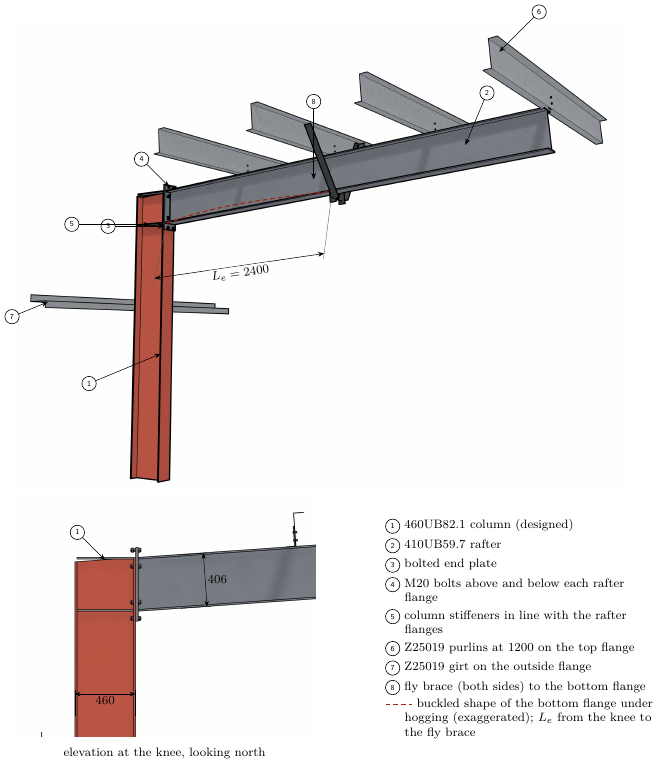
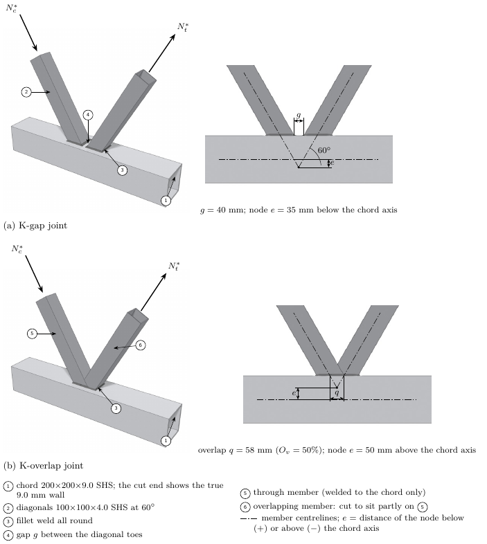
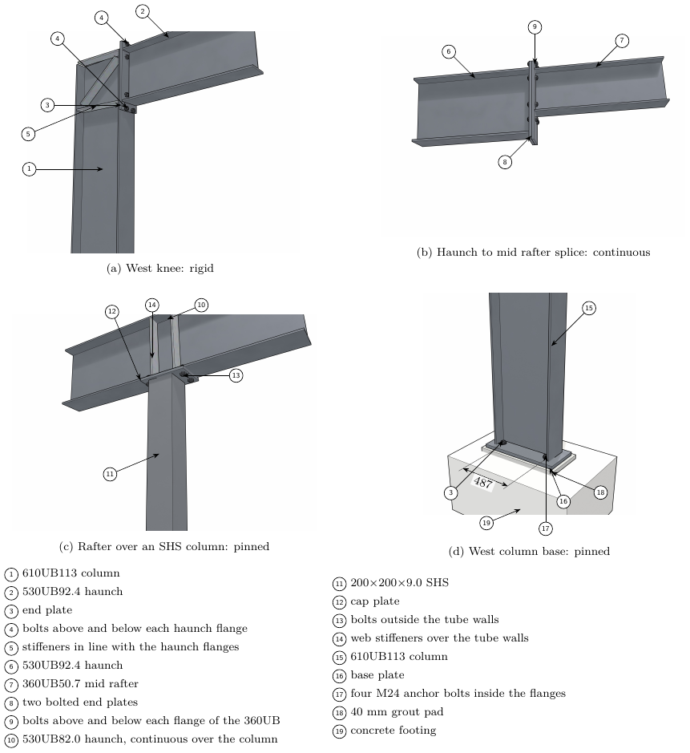
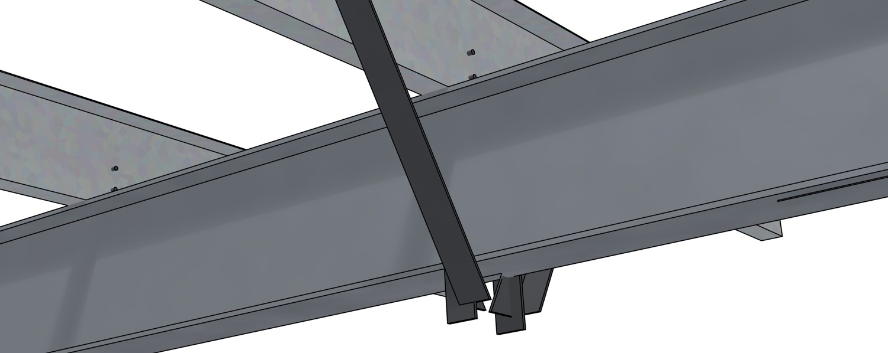
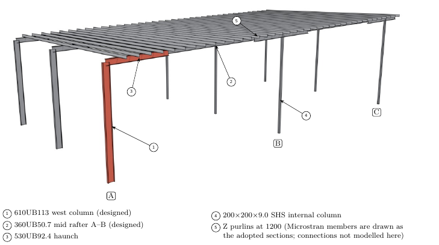
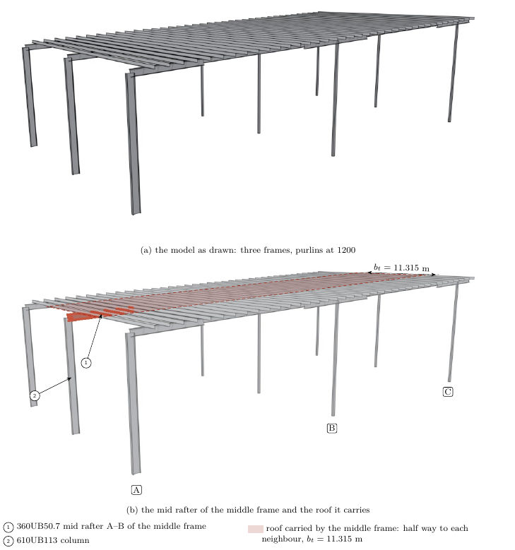

# steelfig

True-size 3D figures of steel structures for reports and teaching: members from the Australian catalogues
(Liberty / OneSteel UB, UC, PFC, angles; Austube SHS, RHS, CHS; Stramit purlins), connections at real
proportions, rendered in Blender as clean grey line-art with one accent colour, annotated in vector TikZ with
numbered balloons, a key and dimension lines that are checked against the model.

Describe a figure in a short TOML file, or in Python for anything unusual, or draw a whole frame straight from a
Microstran `.arc` model. Output: a LaTeX fragment for the report, a preview PDF, and a PNG for Word or slides.

| | |
|---|---|
|  |  |
| `examples/knee/knee.toml`: a portal-frame knee with purlins, girt, fly brace, L_e | `examples/kjoint/`: SHS K-gap and K-overlap joints (Python API) |
|  |  |
| `examples/connections/`: knee, splice, cap and base generated from the sections by one `[[connection]]` each; zero clashes | fly brace as built: on the purlin web, cut under the top flange, bolted, cleat at the flange |
|  |  |
| `examples/frame_from_model/frame.toml`: three frames straight from a Microstran model | `examples/highlight/`: the plain view, then the same view with a member highlighted and its tributary strip, added without re-rendering |

## Install

1. [Blender](https://www.blender.org/download/) 4.2 or later (5.x tested). macOS: `/Applications/Blender.app`;
   elsewhere put `blender` on the PATH or set `BLENDER=/path/to/blender`.
2. Python 3.11+ with Pillow: `pip install pillow` (only for flattening the renders to JPEG).
3. For preview PDFs and LaTeX reports: any TeX (TinyTeX, MacTeX, MiKTeX) with `pdflatex`. For PNG output:
   `pdftoppm` (`brew install poppler`) or `pip install pymupdf`.
4. `git clone … steelfig` and check: `steelfig/bin/steelfig doctor`

## First figure

```bash
bin/steelfig build examples/knee/knee.toml /tmp/knee_out --report /tmp/knee_rep --quick --png
open /tmp/knee_rep/preview/prev_knee.pdf
```

`--quick` renders small (40 %, fewer samples) to check the composition; drop it for the final: by default a view
is rendered at 4200 × 2940 px with 128 samples, ambient occlusion and soft shadows (about 3 s per view on an
Apple-silicon Mac), which prints at ~600 dpi for a 14 cm figure. The knobs are in `steelfig/styles/default.toml`
(`[render]`: resolution, line_width, samples, fast_gi, shadows). Rendering and annotation are
separate: once a view is rendered you can add labels, tint a member (`highlight`), fill a region, add dimensions
and rerun `steelfig annotate …` in under a second. Then copy the scene file, change the sections, points and
labels (see `docs/scene-format.md`), and in the report:

```latex
\begin{figure}[!htbp]\centering
  \input{figures/fig_knee}
  \caption{…}\label{fig:knee}
\end{figure}
```

The preamble needs `\usepackage{tikz,graphicx,amsmath}`, `\usetikzlibrary{arrows.meta}`,
`\definecolor{acc}{rgb}{0.62,0.16,0.10}` and the balloon macro from `steelfig/overlay.py` (`PRE`).
Word users: use `preview/prev_<name>.png` from `--png`.

## What the build does for you

Balloons without `dx`/`dy` are placed automatically off the steel (the ID render says where the steel is), apart
from each other and without crossing leaders. A view without a camera gets one that looks at the accent parts and
fits everything in the frame; adjust it in the browser (`steelfig view`). Every build checks dimension texts
against the model, balloons on members, crossing leaders, parts outside the picture and key numbering, and prints
what it found. Outlines are drawn in a hierarchy (contour / crease / secondary / depth fade). Connection
proportions scale with the member depth. Errors in a scene file come back as one plain line.

## Connections, clashes, finishes

Standard connections are generated from the member sections (`[[connection]] type = "knee" | "splice" | "cap" |
"base"`): end plates, bolt rows either side of the web, stiffeners in line with the flanges, cap plates on the roof
slope, base plates with holding-down bolts. The members named in a connection are trimmed to its faces, so
nothing has to be placed by hand. `check = true` (or `--check`) computes the intersection volume of every pair
of solids and prints `CLASH` lines for members passing through each other; small, intended overlaps (under
5 cm³) are ignored. Members get a finish by product type (hot-rolled mill scale, hollow sections, galvanised
purlins, bolts) from the style sheet; add a finish per grade there if you want C450 to look different from C350.

## Commands

```
steelfig build <scene.toml> <out_dir> [--report <dir>] [--quick] [--no-preview] [--png]
steelfig build-all <folder | set.toml> <out_root> [--report <dir>] [--quick] [--check]   # a report's figures, one style
steelfig annotate <scene.toml> <out_dir> [--report <dir>] [--png]     # labels / highlights only, no Blender
steelfig view <out_dir> [--open]                                        # orbit / zoom the built scene in a browser, read off the camera
steelfig set-camera <scene.toml> <view> "x,y,z,tx,ty,tz,lens"          # write that camera into the scene
steelfig render <fig.py> <out_dir> [quick] [cam=x,y,z,tx,ty,tz,lens]
steelfig sections <query>        # e.g. 360UB, "x8 EA", 150x150, CHS
steelfig model <file.arc>        # nodes, members, property names of an analysis model
steelfig doctor
```

## What the figures must look like

The style rules (what to draw, how to label, one accent colour, no text on the picture) are in
`docs/figure-style.md`; they are what makes the figures read as a fabricator's manual rather than an AI picture.
Every geometric assumption a figure shows (purlin on the top flange, bolts either side of a flange, …) should carry
its source in the caption or key. The dimension texts in `draw` are checked against the model and a mismatch is
printed as a warning. The figures explain; they do not replace hand drawings a course asks for.

## Layout

```
steelfig/        pure Python: sections.py (catalogue), readers.py (Microstran / CSV), overlay.py (TikZ),
                 scene.py (TOML -> build), style.py + styles/, cli.py; data/*.csv (section tables, see data/README.md)
blender/         runs inside Blender: bfig.py (modelling, camera, render), assembly.py (lines, patterns,
                 connections, model import), build_scene.py
examples/        knee (TOML), frame_from_model (TOML + .arc), kjoint (Python)
docs/            scene-format.md, python-api.md, figure-style.md, pitfalls.md
tools/           extract_sections.py (regenerate the CSV tables from the catalogue workbooks)
tests/           python3 -m unittest discover -s tests
```

## Scope

Steel only, Australian designations, AS 4100 practice. Section tables are for drawing at true size, not a
substitute for the catalogue when quoting a property. Concrete, timber and other codes' catalogues are not
included; a new section type is one profile function in `sections.py` plus a CSV row.
